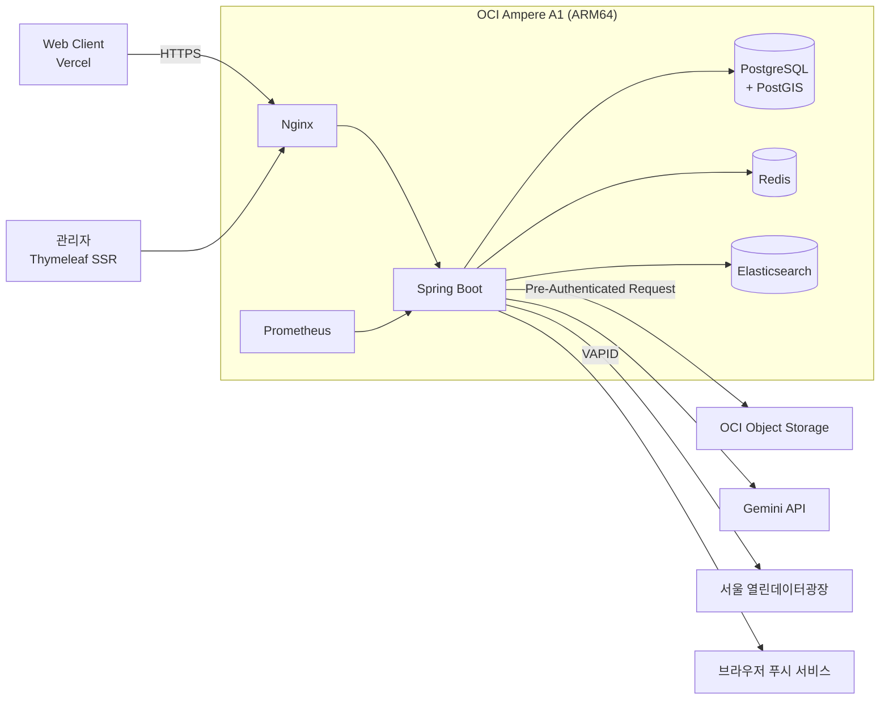

# 짐두고 (Zimdugo) — Backend

> 여행 중 짐 맡길 곳을 지도에서 바로 찾는 전국 물품보관함 지도 서비스

[서비스 바로가기](https://zimdugo.com) · [Frontend 레포](https://github.com/JECT-Study/Zimdugo-4th-Client) · JECT 4기 1팀 · 2026.03 ~ 2026.09

## 소개

역, 박물관, 백화점에 흩어진 물품보관함 정보를 한 지도에 모았습니다. 사용자는 현재 화면이나 키워드로 보관함을 찾고, 크기·실내외·시설 유형으로 거르고, 서울 지하철 보관함은 실시간 잔여 수량까지 확인할 수 있습니다. 이용 종료 시간을 알려주는 웹 푸시 알림도 보낼 수 있습니다.

정보가 없는 보관함은 사용자가 사진과 함께 제보합니다. 관리자는 제보를 검토하고 번역까지 확인한 뒤 승인합니다. 외국인 여행자를 위해 한국어, 영어, 일본어, 중국어 간체·번체 5개 언어를 지원합니다.

## 주요 기능

| 기능 | 설명 |
| --- | --- |
| 지도 핀 조회 | 현재 화면 범위의 보관함을 조회합니다. 줌 15 미만에서는 화면 픽셀 격자 기준으로 클러스터링합니다 |
| 검색 | Elasticsearch에서 언어별 분석기(nori, kuromoji, smartcn, english)로 자동완성과 키워드 검색을 제공합니다 |
| 필터 | 크기(소·중·대), 실내외, 시설 유형을 복합 조건으로 거릅니다 |
| 실시간 잔여 수량 | 서울 열린데이터광장 API를 주기적으로 받아 크기별 잔여 수량을 제공합니다 |
| 이용 종료 알림 | 시작, 종료 N분 전, 종료 시점에 웹 푸시(VAPID)를 예약 발송합니다 |
| 제보·검수 | 사진 메타데이터를 추출해 저장하고, 제보 → 초안(DRAFT) → 번역 검수 → 최종 승인 순서로 처리합니다 |
| 관리자 | Thymeleaf SSR 관리자 페이지에서 보관함, 제보, 공지, 점검 공지, 검색어 통계를 관리합니다 |
| 인증 | Google·Naver·Kakao OAuth2 로그인 후 JWT를 발급하고, Refresh Token은 Redis에 저장합니다 |

## 기술 스택

| 분류 | 기술 |
| --- | --- |
| Language / Framework | Java 25, Spring Boot 4.0, Spring Data JPA, Spring Security |
| Database | PostgreSQL 16 + PostGIS 3.5, Redis 7 |
| Search | Elasticsearch 9.2 (nori, kuromoji, smartcn, icu) |
| Infra | OCI Ampere A1 (ARM64), OCI Object Storage, Docker Compose, Nginx |
| CI/CD | GitHub Actions, GHCR, self-hosted runner |
| Monitoring | Spring Actuator, Prometheus, Grafana |
| External | Google Gemini (번역 검수), 서울 열린데이터광장, Kakao Local API, Web Push |
| Test | JUnit 5, Mockito, Testcontainers (PostGIS), Checkstyle |

## 아키텍처



- `main` 브랜치에 머지하면 GitHub-hosted runner가 테스트와 ARM64 이미지 빌드를 맡고, OCI의 self-hosted runner가 GHCR에서 이미지를 받아 배포합니다.
- 패키지는 도메인(`locker`, `push`, `auth`, `admin` ...)별로 나누고, 각 도메인 안을 `entrypoint` → `application` → `domain` ← `infrastructure` 의존 방향으로 구성했습니다.

## 설계 결정

### 검색 경로와 통계 집계 분리 — Transactional Outbox

검색할 때마다 검색어 통계를 바로 갱신하면 검색 응답이 통계 테이블 갱신을 기다리게 됩니다. 그래서 검색 API는 Outbox 이벤트만 저장하고, 스케줄러가 이벤트를 배치로 모아 전체·일별 통계에 합산합니다. 배치는 `FOR UPDATE SKIP LOCKED`로 가져와서, 인스턴스가 여러 대여도 같은 이벤트를 두 번 집계하지 않습니다. ([#114](https://github.com/JECT-Study/Zimdugo-4th-Server/pull/114))

### DB와 검색 인덱스 동기화

보관함 데이터가 바뀌면 Elasticsearch 인덱스 동기화를 비동기로 분리했습니다. 실패하면 재시도하고, 인덱스를 새로 만들 때는 구버전 인덱스를 정리합니다. 인덱스가 준비되기 전에는 readiness를 내려서, 검색이 빈 결과를 반환하는 상태로 트래픽을 받지 않게 했습니다. ([#84](https://github.com/JECT-Study/Zimdugo-4th-Server/pull/84), [#94](https://github.com/JECT-Study/Zimdugo-4th-Server/pull/94))

### 예약 푸시 발송 — 작업 선점과 트랜잭션 밖 발송

예약된 알림 작업은 조건부 UPDATE로 리스(lease)를 걸어 선점합니다. 실제 푸시 발송은 DB 트랜잭션 밖에서 하고, 결과는 짧은 트랜잭션으로 반영합니다. 서버가 발송 도중 중단되면 리스가 만료된 작업을 다시 대기 상태로 되돌려 복구합니다. 응답하지 않는 푸시 서비스가 공유 스케줄러 스레드를 붙잡지 않도록 발송 대기 시간을 제한했습니다. 서버가 예약 시점에 직접 요청을 보내는 주소이기 때문에, 구독 주소는 브라우저 벤더의 푸시 서비스 호스트만 허용합니다. ([#142](https://github.com/JECT-Study/Zimdugo-4th-Server/pull/142), [#144](https://github.com/JECT-Study/Zimdugo-4th-Server/pull/144), [#146](https://github.com/JECT-Study/Zimdugo-4th-Server/pull/146))

### 외부 실시간 데이터는 마지막 정상 스냅샷 유지

서울 지하철 보관함 API 응답에서 페이지, 전체 건수, 필수 필드, 중복 ID를 검증하고, 하나라도 불완전하면 동기화 전체를 중단합니다. 그러면 일부만 갱신된 상태가 아니라 마지막 정상 스냅샷이 유지됩니다. 외부 API 호출은 트랜잭션 밖에서 하고, 매핑과 기존 상태는 일괄 조회·저장해 N+1을 막았습니다. ([#117](https://github.com/JECT-Study/Zimdugo-4th-Server/pull/117))

### 지도 핀 조회를 DB에서 확정

처음에는 범위 안의 보관함을 모두 가져온 뒤 Java에서 필터를 적용했습니다. 지금은 범위, 크기, 실내외, 유형 조건을 모두 SQL에서 확정해 반환 행을 줄입니다. 범위 조건은 측정 결과를 근거로 geography 경계 상자 대신 위경도 복합 인덱스를 씁니다. geography 경계 상자는 화면 밖 보관함까지 포함했고 더 느렸습니다. ([#120](https://github.com/JECT-Study/Zimdugo-4th-Server/pull/120), [측정 기록](docs/performance/locker-query-benchmark.md))

### 클라우드 자격 증명을 서버에 두지 않기

OCI Object Storage는 Instance Principal로 인증합니다. 그래서 서버에 API 키 파일을 두지 않습니다. 클라이언트에는 객체 하나에만 쓸 수 있고 짧은 시간만 유효한 Pre-Authenticated Request를 발급해서 직접 업로드하게 합니다. ([#111](https://github.com/JECT-Study/Zimdugo-4th-Server/pull/111))

## 성능 측정

| 대상 | 조건 | 결과 |
| --- | --- | --- |
| 지도 핀 조회 (좁은 화면) | 보관함 10만 개 | 0.94ms → 0.49ms, 반환 행 101 → 80 |
| 지도 핀 조회 (넓은 화면) | 보관함 10만 개 | 42.8ms → 34.1ms, 화면 밖 보관함 반환 제거 |

현재 운영 규모(보관함 약 1,000개)에서는 모든 조회가 1ms 미만입니다. 측정 방법과 해석, 재현 스크립트는 [측정 기록](docs/performance/locker-query-benchmark.md)에 있습니다.

## 테스트

- 단위·통합 테스트 약 440개
- PostGIS 전용 네이티브 쿼리(공간 조건, `LATERAL` 집계, 크기 필터)는 H2로 검증할 수 없어서, Testcontainers PostGIS로 실제 DB에서 검증합니다. Docker가 없는 환경에서는 이 테스트를 건너뜁니다.
- Checkstyle을 CI와 pre-commit hook에서 함께 검사합니다.

```bash
./gradlew check
```

## 로컬 실행

```bash
docker compose up -d
./gradlew bootRun
```

OAuth, OCI Object Storage 설정은 [로컬 실행 가이드](docs/local-run.md)를 참고하세요.

## 팀

| 역할 | GitHub |
| --- | --- |
| Backend | [@mike7643](https://github.com/mike7643), [@buddle031](https://github.com/buddle031), [@zxcv9203](https://github.com/zxcv9203) |
| Frontend | [Zimdugo-4th-Client](https://github.com/JECT-Study/Zimdugo-4th-Client) |
